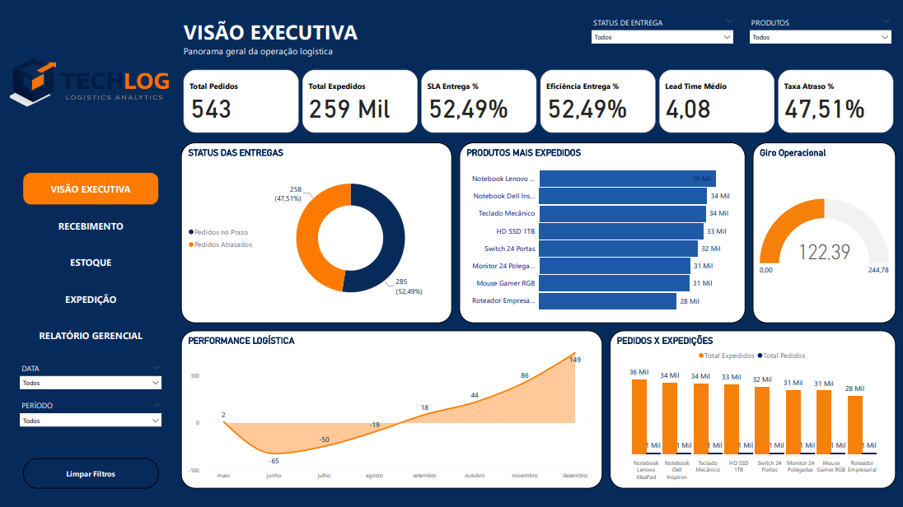
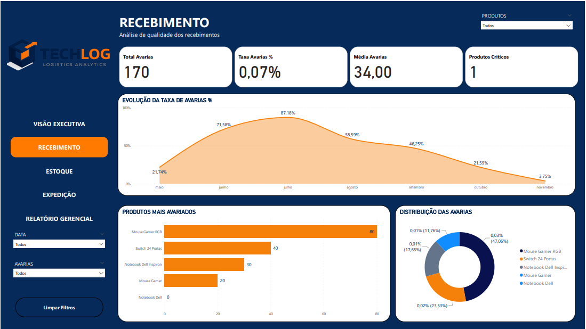
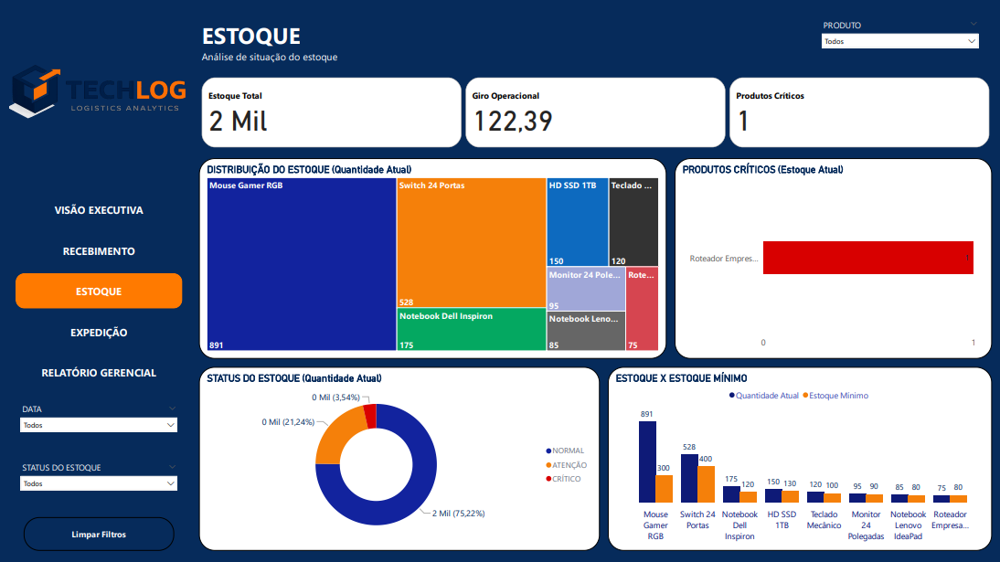
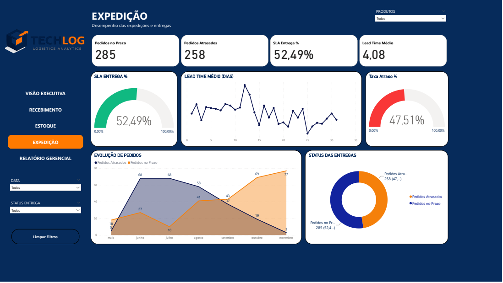
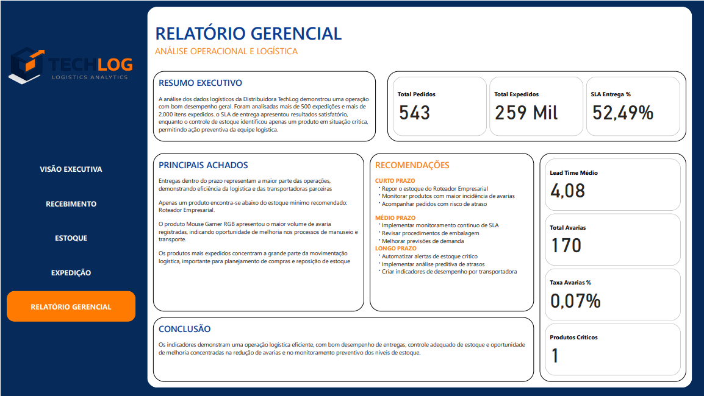

# 📊 TechLog — Análise de Dados e Business Intelligence Logístico

Projeto de análise de dados aplicado à operação logística de uma distribuidora, desenvolvido com **MySQL, Python e Power BI**.

O objetivo é transformar dados operacionais em informações relevantes para acompanhar indicadores, identificar gargalos e apoiar a tomada de decisão.

## 🎯 Objetivo do projeto

Desenvolver uma solução de Business Intelligence para monitorar diferentes etapas da operação logística:

- Recebimento de mercadorias;
- Controle e movimentação de estoque;
- Expedição de pedidos;
- Acompanhamento de entregas;
- Monitoramento de avarias e atrasos.

## 🛠️ Tecnologias utilizadas

| Tecnologia | Aplicação |
|---|---|
| MySQL | Armazenamento e consultas aos dados |
| Python | Desenvolvimento do processo ETL |
| Pandas | Manipulação e tratamento dos dados |
| NumPy | Transformações e classificações |
| Power BI | Modelagem, análise e visualização |

## 🔄 Arquitetura do projeto

O projeto utiliza um fluxo de integração e transformação de dados:

**MySQL → Python (ETL) → Tratamento dos dados → CSV/Excel → Power BI**

O processo permite extrair informações do banco de dados, realizar tratamentos com Python e disponibilizar os dados para análise no Power BI.

## 📈 Indicadores analisados

- Total de pedidos;
- Total de pedidos expedidos;
- SLA de entrega;
- Eficiência de entrega;
- Lead time médio;
- Taxa de atraso;
- Total e taxa de avarias;
- Produtos com estoque crítico;
- Giro operacional.

## 📊 Dashboards

O relatório foi organizado em cinco áreas de análise:

### 1. Visão Executiva

Panorama geral da operação e acompanhamento dos principais indicadores.



### 2. Recebimento

Monitoramento do recebimento de mercadorias e das ocorrências de avarias.



### 3. Estoque

Acompanhamento dos níveis de estoque e identificação de produtos críticos.



### 4. Expedição

Análise das expedições, entregas, atrasos e desempenho logístico.



### 5. Relatório Gerencial

Consolidação dos resultados e informações para apoio à gestão.



## 📁 Estrutura do repositório

```text
TechLog-Logistics-Analytics/
│
├── Dashboard_Images/
├── Data/
│   ├── Export/
│   ├── Processed/
│   └── Raw/
│
├── PowerBI/
│   ├── TechLog_Logistica.pdf
│   └── TechLog_Logistica.pbix
│
├── Python_ETL/
│   └── etl_techlog.py
│
├── SQL/
│   ├── consultas_kpis/
│   ├── inserts_techlog/
│   └── schema_techlog/
│
└── README.md
```

## 📄 Relatório Power BI

O relatório exportado em PDF está disponível em:

[Visualizar relatório Power BI](PowerBI/TechLog_Logistica.pdf)

O arquivo `.pbix` também está disponível no repositório para consulta e exploração no Power BI Desktop.

## 💡 Escopo das análises

O projeto contempla análises de desempenho logístico, controle de estoque, avarias, lead time e cumprimento de prazos.

Os resultados quantitativos e os principais insights serão documentados após a validação dos dados e das regras de negócio.

## 👨‍💻 Autor

**Patrick do Nascimento Santos**

- [LinkedIn](https://www.linkedin.com/in/patrick-nascimento-b2960b236/)
- [GitHub](https://github.com/VisPatrick)

---

*Projeto desenvolvido para aplicação prática de SQL, Python, ETL, análise de dados e Business Intelligence no contexto de operações logísticas.*
